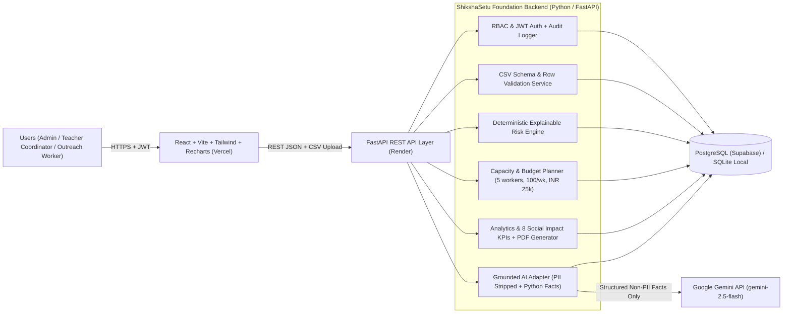

# ShikshaSetu Foundation — Technical Architecture & Data Flow

## System Architecture Diagram

## AI Responsibility Matrix (Challenge A Task C & D)

| Component | Approach Used | Rationale & Safeguard |
|---|---|---|
| Attendance validation & capacity limits | Deterministic Rules | Predictable enforcement of `0-100%` attendance, `4 visits/worker/day`, `100/week`, and `INR 25,000` budget. |
| School comparison & before/after change | Traditional Analytics (Pandas / SQL) | Reproducible descriptive metrics; explicitly avoids claiming causation from before/after comparisons. |
| Student review prioritization | Transparent Rule-Based Scoring | Dataset A2 has only 12 synthetic records and zero verified dropout labels; weights are documented and teacher-overridable. |
| Future predictive risk model | Supervised ML (Scikit-learn, Deferred) | Evaluated only once longitudinal, consented, outcome-labelled cohort data exists. |
| Teacher explanations & checklists | Generative AI (Gemini API via Adapter) | Grounded strictly in verified PostgreSQL facts; zero PII sent to external LLM; human reviews outputs. |
| Proposed weekly outreach queue | Controlled Human-Gated Workflow | Generates proposed assignments; requires Teacher/Admin approval before scheduling. |
